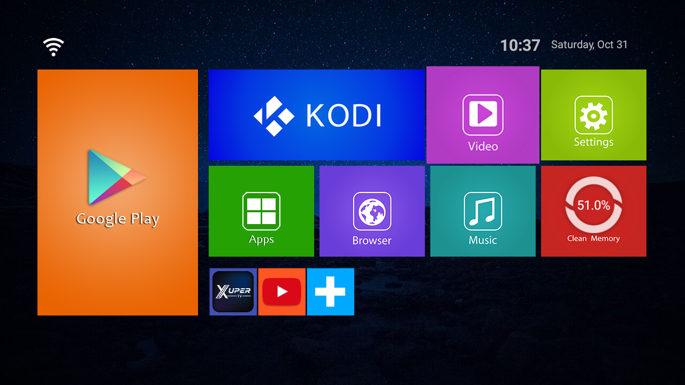
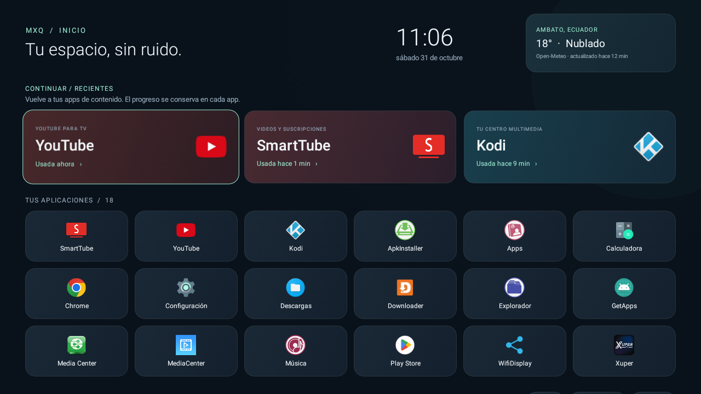

# MXQ TV Box: diagnóstico y personalización por ADB

Proyecto en PowerShell y Java para personalizar una MXQ-4K 5G con unos 1 GiB de RAM. **Estado: cambios aplicados al dispositivo, nuevo launcher instalado y botón Home configurado.** El launcher de fábrica sigue habilitado.

**[Descargar el launcher en Releases](https://github.com/xJhony911/mxq-tvbox-setup/releases) · [Instalación paso a paso](INSTALACION.md) · [Cambios y validación](CAMBIOS.md)**

## Antes

Captura real del launcher de fábrica, tomada por ADB el 31 de octubre de 2026:



## Después

Captura real de **MXQ Inicio**, el launcher propio compilado para Android API 25:



Incluye hora, clima de Ambato (Open-Meteo), recientes por uso y cuadrícula de apps con navegación D-Pad. SmartTube y YouTube tienen prioridad en la interfaz. El código y los scripts están en este repositorio. No es una maqueta.

## Hallazgos

| Dato | Resultado observado |
| --- | --- |
| Android declarado por la ROM | `10.1` |
| SDK reportado | `25`, correspondiente a Android 7.1 |
| Procesador | Rockchip RK3229, 4 núcleos ARMv7 |
| ABI de aplicaciones | `armeabi-v7a` / `armeabi`, 32 bits |
| RAM | `free -m`: 995 MiB; `/proc/meminfo`: 4096 MiB, lectura contradictoria |
| Almacenamiento de usuario | `/data`: 3.8 GiB totales, aproximadamente 1.0 GiB libres |
| Características de la ROM | `box` |
| Launcher original | `com.droidlogic.mboxlauncher/.Launcher`, conservado |
| Nuevo launcher predeterminado | `ec.mxq.inicio/.MainActivity` |

El SDK, el identificador de compilación y el parche de seguridad son consistentes con una base antigua de Android 7.1. La memoria observada por `free` y las zonas de memoria sugieren aproximadamente 1 GiB de RAM. Estos datos proceden del firmware; no constituyen una medición física independiente del hardware. Ver [el diagnóstico completo](DIAGNOSTICO.md).

## Uso en Windows PowerShell

Instala las [Platform Tools oficiales](https://developer.android.com/tools/releases/platform-tools) y habilita la depuración en tu propia TV Box. Sustituye el destino de ejemplo por la dirección que corresponda:

```powershell
adb connect DIRECCION_DE_TU_TV:5555
.\Get-TvBoxDiagnostics.ps1 -Serial 'DIRECCION_DE_TU_TV:5555'
.\Capture-TvBox.ps1 -Serial 'DIRECCION_DE_TU_TV:5555'
```

Antes de aplicar cambios en otro dispositivo, crea su propio backup:

```powershell
.\Backup-TvBox.ps1 -Serial 'DIRECCION_DE_TU_TV:5555'
```

`Apply-LightCleanup.ps1` corresponde a dos herramientas de pruebas de esta ROM; no es una lista universal para cualquier TV. `Install-SmartTube.ps1` obtiene la versión estable desde GitHub oficial y selecciona la ABI detectada.

Los resultados nuevos se guardan en `local/`, excluido de Git. El script de diagnóstico solo consulta datos. El script de captura fotografía la pantalla actual; no pulsa Home ni cambia ajustes. Revisa cada captura antes de publicarla. La captura PNG usa un flujo binario para evitar alteraciones por la redirección de Windows PowerShell 5.1.

## Cambios aplicados

- Backups privados de paquetes, propiedades y ajustes originales; script `restore_tvbox.ps1`.
- Deshabilitación reversible de `com.cghs.stresstest` y `com.factorytools.factorystability`. No se desinstalaron paquetes de sistema.
- Animaciones `0.5x` (originalmente estaban apagadas en `0`).
- SmartTube estable 32.68 para ARM de 32 bits, desde su repositorio oficial.
- MXQ Inicio instalado, permiso de estadísticas de uso concedido y Home verificado. No requiere servicio de accesibilidad.
- Mejoras de la interfaz: iconos en caché, reutilización de la cuadrícula, consultas fuera del hilo de pantalla y animación breve de foco sin sombras costosas.

Se conservaron Google Play Services, Play Store, Kodi y YouTube. Xuper se actualizó del APK aportado por el propietario; después se pausó ese trabajo a petición suya. La extracción de otra versión desde un Fire Stick queda pendiente para otro momento. Ver [cambios y validación](CAMBIOS.md).

En API 25 se usa una fila de **apps recientes**, no el proveedor Watch Next de API 26. La fila reabre la app; el punto exacto de reproducción depende de cada aplicación. El historial permanece en la caja. El clima usa coordenadas públicas del centro de Ambato y se consulta cada 15 minutos mientras el menú está abierto; no requiere GPS ni clave API.

## Restaurar

Conserva la carpeta privada `local/baseline/` junto al script. El repositorio público no contiene el estado específico de la caja.

```powershell
# Restaurar ajustes cambiados, paquetes deshabilitados y Home original
.\restore_tvbox.ps1 -Serial 'DIRECCION_DE_TU_TV:5555'

# Reactivar un paquete concreto
.\restore_tvbox.ps1 -Serial 'DIRECCION_DE_TU_TV:5555' -Packages 'com.cghs.stresstest'

# Recuperar y abrir el menú original
.\restore_tvbox.ps1 -Serial 'DIRECCION_DE_TU_TV:5555' -EmergencyHome
```

La restauración conserva las apps nuevas y sus datos. No revierte automáticamente la versión de Xuper ni exporta sus datos de cuenta. Se guardó una copia local del APK anterior. La compilación ART puede regenerarse por Android y no afecta a los datos de usuario.

## Compilar el launcher

Se necesitan JDK 17, `android.jar` de API 25 y Android Build Tools 35.0.0. Las herramientas se obtienen de [Eclipse Temurin](https://adoptium.net/) y [Android](https://developer.android.com/tools/releases/platform-tools). No se incluyen sus binarios en Git.

```powershell
.\Build-Launcher.ps1 -JavaHome 'RUTA_JDK_17' -AndroidJar 'RUTA_ANDROID_JAR' -BuildTools 'RUTA_BUILD_TOOLS'
```

El APK y su clave de firma de desarrollo se generan en `local/`. Conserva tu clave para poder actualizar esa instalación. Esta es una compilación para uso local, no una firma de distribución de una tienda.

## Referencias

- [ADB: documentación oficial](https://developer.android.com/tools/adb).
- [Correspondencia entre versión de Android y API](https://developer.android.com/tools/releases/platforms).
- [ART y compilación](https://source.android.com/docs/core/runtime/configure).
- [Open-Meteo](https://open-meteo.com/), datos meteorológicos bajo CC BY 4.0.
- [CleanYourTV](https://github.com/Gathin23/cleanyourtv), inspiración para el flujo reversible. Este repositorio contiene scripts propios; no es un fork ni una distribución del código de CleanYourTV.

No se publican las propiedades completas, direcciones de red, números de serie, credenciales ADB ni APK de terceros.
